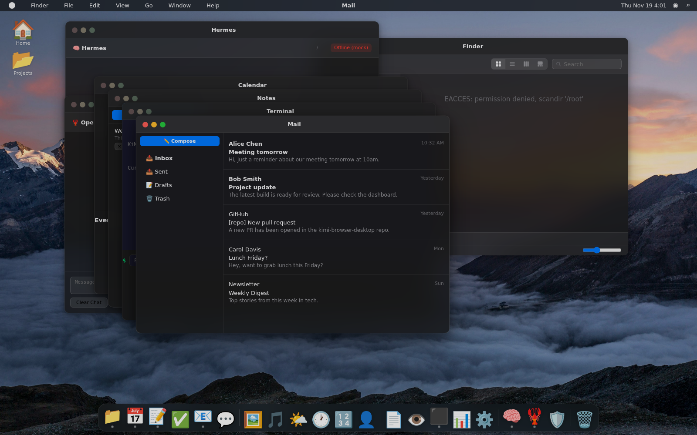
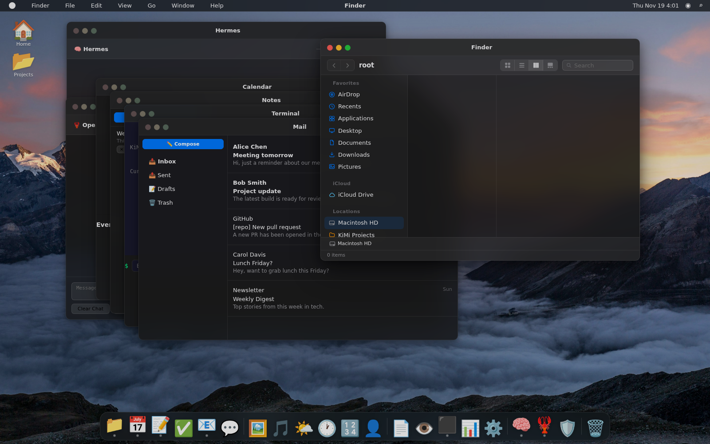
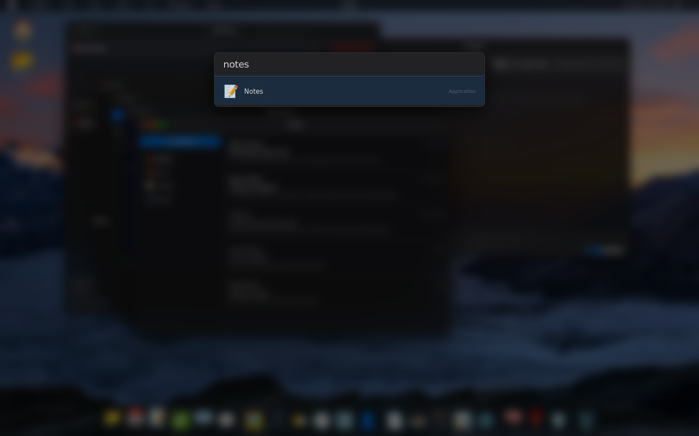
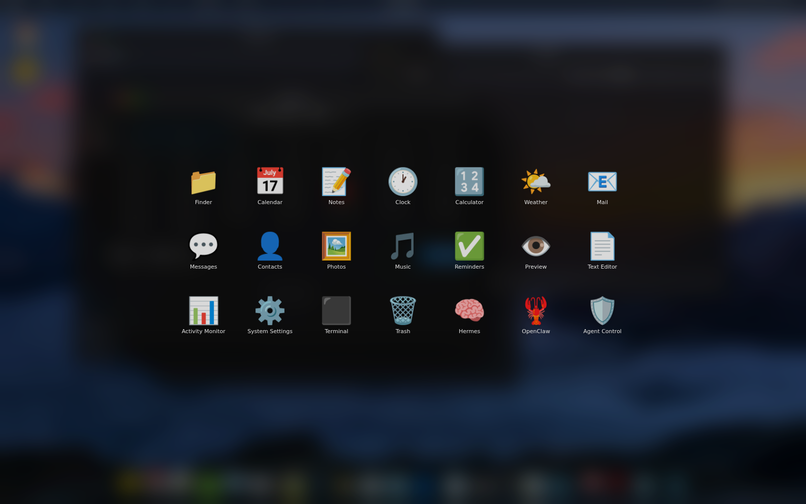

# OpenOS Bench

**A benchmark for how well language models can build a desktop operating system experience.**

Same task since July 2026. New open-weight model every night. Daily evidence in the open.

**→ [ROADMAP.md](ROADMAP.md): 10+ scored runs by New Year's Eve.**

## The baseline, photographed

| Desktop | Finder (column view) | Spotlight | Launchpad |
|---|---|---|---|
|  |  |  |  |

Full evidence gallery (11 states), grading rubric and scorecard: [docs/runs/run-01-kimi-k3.md](docs/runs/run-01-kimi-k3.md). Want to judge it yourself? The 3-minute click path is [docs/DEMO.md](docs/DEMO.md).

Same task, new model, every time. The task: build a macOS-class desktop that runs in the browser on a Linux server - Finder, Dock, Spotlight, Launchpad, windows with the animations that make macOS feel like macOS, and a suite of working apps (Mail, Calendar, Chat, Notes, Weather, Preview, Terminal, and GUI panels for AI coding agents). Score it with automated end-to-end probes plus a human pass. Collect the screenshots. Repeat whenever a notable new model ships.

## Why

Every capable open-weight model claims to write real software. OpenOS Bench turns that claim into something you can click. It is deliberately ambitious: a desktop is frontend fidelity, state persistence, file-system APIs, animation physics, and app integration at once - failures show up as feel, not just as stack traces.

This project also doubles as a story about agent-built software: how an overnight coding-agent run produced the baseline, what the harness looks like, and where each model lands on the same measured bar.

## Run 01 - baseline: Kimi K3 (July 2026)

Built by an OpenCode coding agent driving the model over multiple overnight sessions (implementation pass + logo fix pass + final polish pass), on an Ubuntu server, served over HTTP from a small Node/Express backend.

Run-01 verification (recorded in STATUS.md and the supervisor build logs from the July sessions):
- **21/21 apps render**, **15/15 interaction probes pass**, persistence verified across reloads
- The E2E harness itself was run ephemerally in those sessions and is **not yet committed** - rebuilding it as a permanent part of the benchmark is task #1 of this repo's roadmap (see `docs/` and the supervisor logs for what was probed)

Feature highlights of the baseline:
- **Finder**, macOS-grade: icon / list / column / gallery views, sidebar with Favorites, Locations and Tags, Get Info, inline rename, context menus, path + status bar with real free-space stats
- **Dock**: cosine magnification, launch bounce, genie minimize-to-dock, running indicators
- **Windows**: multi-layer shadows, open/close/zoom animations, 8-way resize, traffic-light controls
- **Spotlight** and **Launchpad**
- **Apps**: Mail, Calendar, Chat, Notes, Weather, Preview, Calculator, Terminal (sandboxed), plus agent GUI panels
- **Real filesystem APIs** behind the browser app: browse, rename, move-to-trash, thumbnails, free space - with whitelist + denylist protections server-side

## Repository layout

```
server.js, routes/      Express backend (fs API with path allow-lists)
public/                 frontend (desktop shell, apps, styles)
supervisor/             autonomous phase runners + build logs (the overnight agent harness)
docs/                   build stories and pass notes
docs/runs/              one story page per scored run (run-01: Kimi K3)
docs/DEMO.md            human-pass click path, with Run 01 reference captures
docs/HUMAN_EVAL_RUBRIC.md  grading: weights, scales, automated-probe mapping
eval/                   task spec + model adapter contract
screenshots/            per-run evidence (<run-id>/ galleries, committed with each score)
```

## How to run

```bash
npm install
node server.js            # serves the desktop (default port 3080)
# E2E harness is being re-committed as roadmap task #1;
# until then, STATUS.md + supervisor/ logs are the run-01 evidence.
```

## The benchmark loop

1. Pick the model under test. Wire it into the adapter contract (`eval/adapter-contract.md`) - any provider that speaks the harness CLI pattern works.
2. Run the fixed task spec against it (`eval/task-spec.md`): build-or-extend the desktop per the spec's scope, same prompts, same sessions ceiling.
3. Score: automated suites, then a short human pass (feel, fidelity, broken surfaces), then optional LLM-judge for a second opinion.
4. Record: screenshots to `screenshots/<run-id>/`, results row added below, story notes to `docs/`.

## Results table

| Run | Model      | Date   | Apps (21) | Probes (15) | Persist | Human pass | Notes |
|-----|------------|--------|-----------|-------------|---------|------------|-------|
| 01  | Kimi K3    | 2026-07| 21/21     | 15/15       | ✅      | 84/100 (operator, provisional) | baseline; 16/16 hard reqs |
| 02  | GLM-5.3    | 2026-11| 21/21*    | 16 apps     | ✅      | 75/100 (agent prov.) | neutral harness 7/8 (88%); walkthrough can override |

Run-02 story: [docs/runs/run-02-glm-5.3.md](docs/runs/run-02-glm-5.3.md)

Grading rubric: [docs/HUMAN_EVAL_RUBRIC.md](docs/HUMAN_EVAL_RUBRIC.md) · Demo & human-pass click path: [docs/DEMO.md](docs/DEMO.md)

The bench fills nightly: GLM-5.3 (done, run-02), Qwen3.8-Max, MiniMax-M3, MiMo-v2.5-Pro, Kimi-K2.7-Code, LongCat-2.0, Hunyuan hy4-preview, plus December wildcards. Full schedule and scoring plan in [ROADMAP.md](ROADMAP.md).

## License

MIT - fork it, make it your own, run your own model bake-off.
