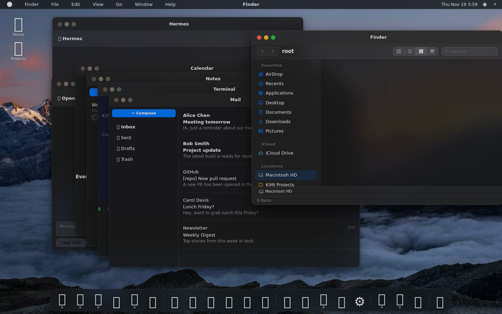
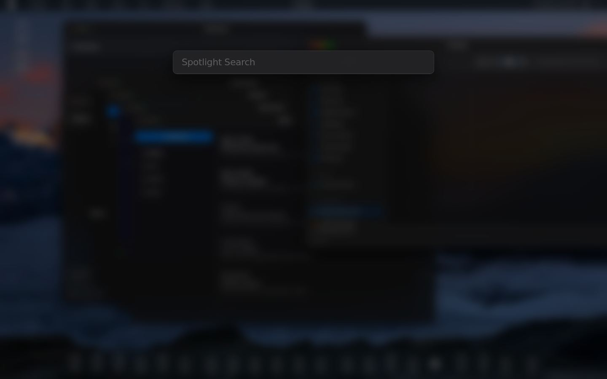
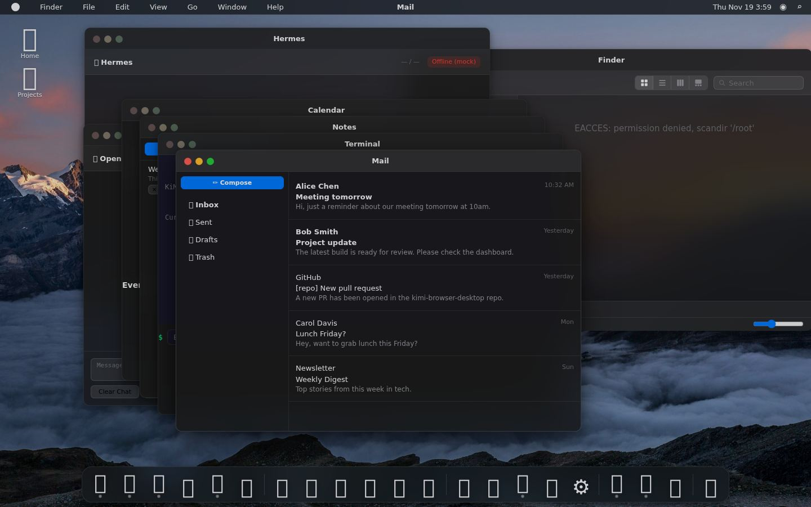

# OpenOS Bench - Demo & Human-Pass Click Path

The same click path is run against any build for the human pass. Each step lists what to do, what a passing result looks like, and the reference capture from Run 01 (Kimi K3 baseline, re-captured live 2026-11-19).

| # | Click path | Expected pass | Fail signals |
|---|-----------|---------------|--------------|
| 1 | Open the URL, let it settle | Desktop paints with wallpaper, menu bar with live clock, Dock magnifies on hover | FOUC, light/dark flash, missing chrome |
| 2 | Click **Finder** in the Dock → switch views (⌘1/⌘2/⌘3) → navigate a folder | Real filesystem listing through the backend API; breadcrumbs + status bar update; view switch is instant | Empty grid, stale path bar, console errors |
| 3 | Press **⌘-Space**, type `Notes` | Spotlight overlay opens, fuzzy match ranks Notes first | No overlay, no fuzzy ranking |
| 4 | Press **Enter**, type a sentence in Notes | App launches from Spotlight; note text accepts input | Launch failure, dead textarea |
| 5 | **Reload the page** | Window layout and theme come back exactly as saved (server-side state, not localStorage) | Fresh desktop, lost theme |

Manual addendum for step 5: app-level content persistence (typed note text after reload) is checked by hand during each run's human pass and reported per run - Run 01 restores layout and theme; see the run story for content-level results.

## Run 01 reference captures

## Grading

The pass/fail judgment per step feeds the scorecard in [docs/HUMAN_EVAL_RUBRIC.md](HUMAN_EVAL_RUBRIC.md). The human pass is primary; automated probes report first, a human verdict finalizes.
