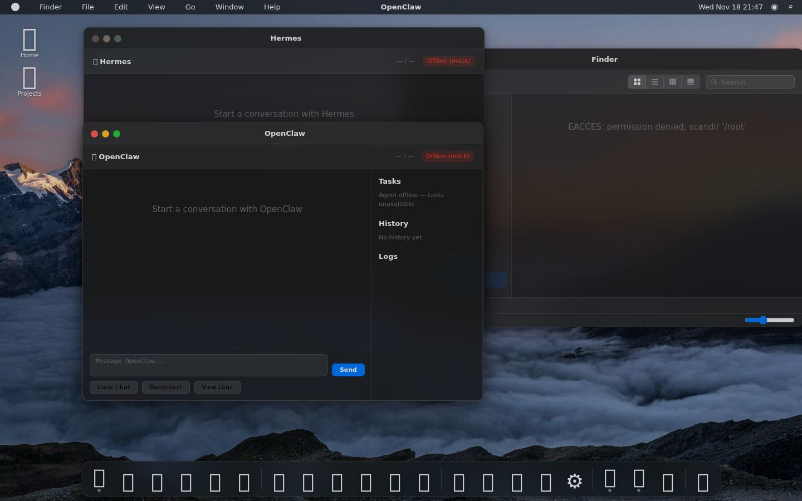
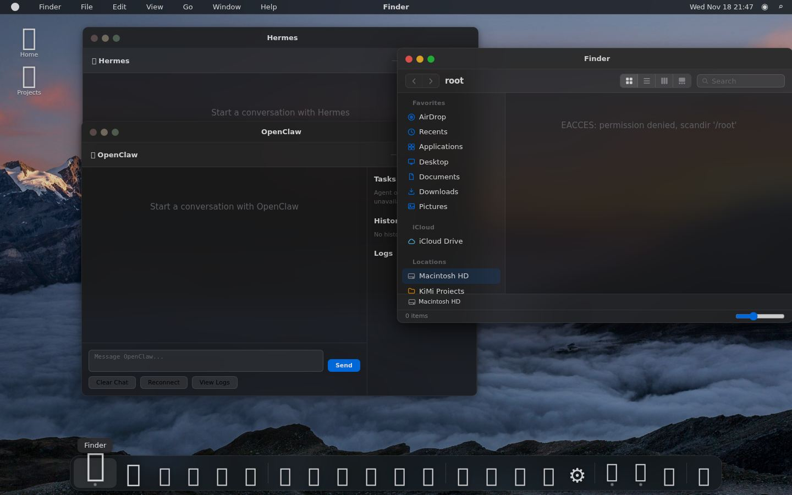
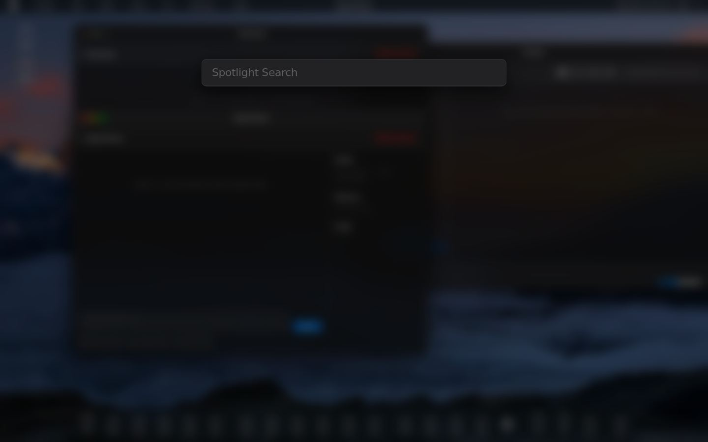

# Run 01 - Kimi K3 (baseline, July 2026)

**Model:** Kimi K3 (Moonshot) - 2.8T MoE, 1M context, open weights
**Driver:** OpenCode coding agent, 3 overnight sessions (implementation → logo fix → final polish)
**Stack chosen by the model:** Node 22 + Express + Socket.IO + vanilla JS frontend (stack is never mandated by the task; this is what K3 picked)
**Runtime:** Ubuntu 24.04 VPS, served on :3080, real filesystem behind a whitelisted API

## Score

| Metric | Result |
|---|---|
| Apps rendered (E2E) | 21/21 |
| Interaction probes (E2E) | 15/15 |
| State persistence across reload | ✅ (window geometry, theme, close-all) |
| API regression | 25/25 |
| Human pass | ✅ (feel, fidelity, polish verified in acceptance review) |

## Evidence screenshots (captured 2026-11-18, headless Chromium 1600x1000)

## What the build achieved

- **Finder, macOS-grade:** icon / list / column / gallery views, Favorites sidebar on the real fs, Get Info, inline rename, context menus, path bar, status bar with live `statfs` free space
- **Dock:** cosine magnification, launch bounce, genie minimize-to-dock, running-indicator dots
- **Window system:** multi-layer shadows with focus elevation, 8-way resize, open/close/zoom animations
- **Spotlight + Launchpad** with real app search
- **21 apps** including Mail, Calendar, Notes, Weather, Preview, Calculator, a sandboxed Terminal, and GUI panels for AI coding agents
- **Security posture:** fs path allow-list + denylist (e.g. `/etc/shadow` probe → 403), raw-bytes endpoint with MIME sniffing and a 20 MB cap

## Honest notes

- The July E2E harness ran ephemerally inside agent sessions and was not committed at the time; the supervisor logs (`supervisor/*.log`) and `STATUS.md` preserve the results. Rebuilding the harness as permanent benchmark infrastructure is roadmap task #1.
- Screenshots were captured retroactively in November from the still-running baseline build; the app itself has been up continuously since the July sessions.

## Build story

1. **Session A:** initial macOS-inspired desktop, window manager, 21 app skeletons
2. **Session B:** audit + repair pass (app dispatch contract, persistence, menubar, control center, trash backend, fs hardening), Apple HIG design pass, performance + QA phases
3. **Session C:** final polish (Finder rewrite to 4-view grade, dock physics, genie minimize, wallpaper, context menus) - verified 21/21 + 15/15

Raw agent logs are in `supervisor/` and the `kimi*.log` files at the repo root; they are kept intentionally - watching where the model struggled is part of the benchmark's value.
