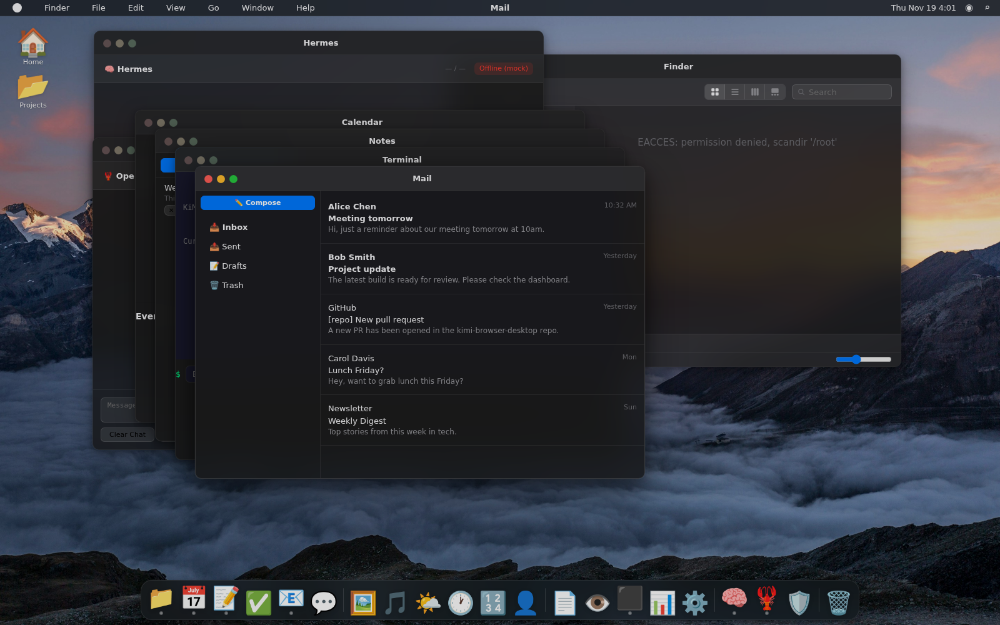
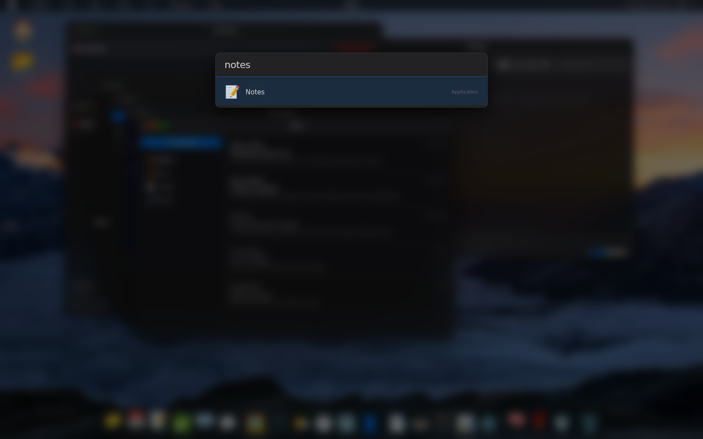
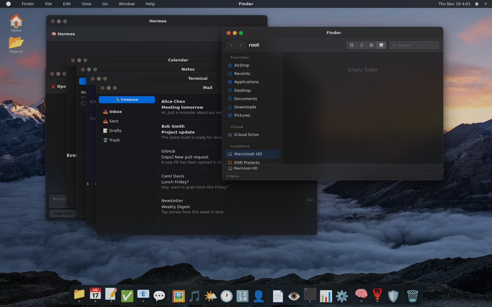
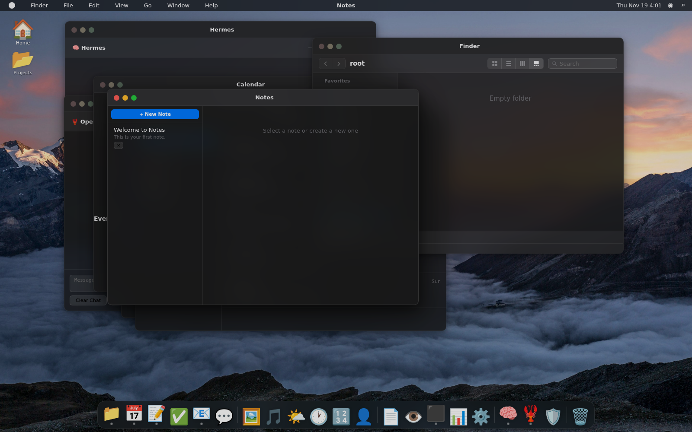
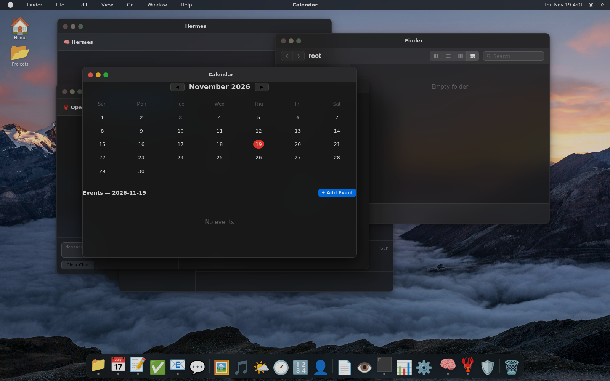
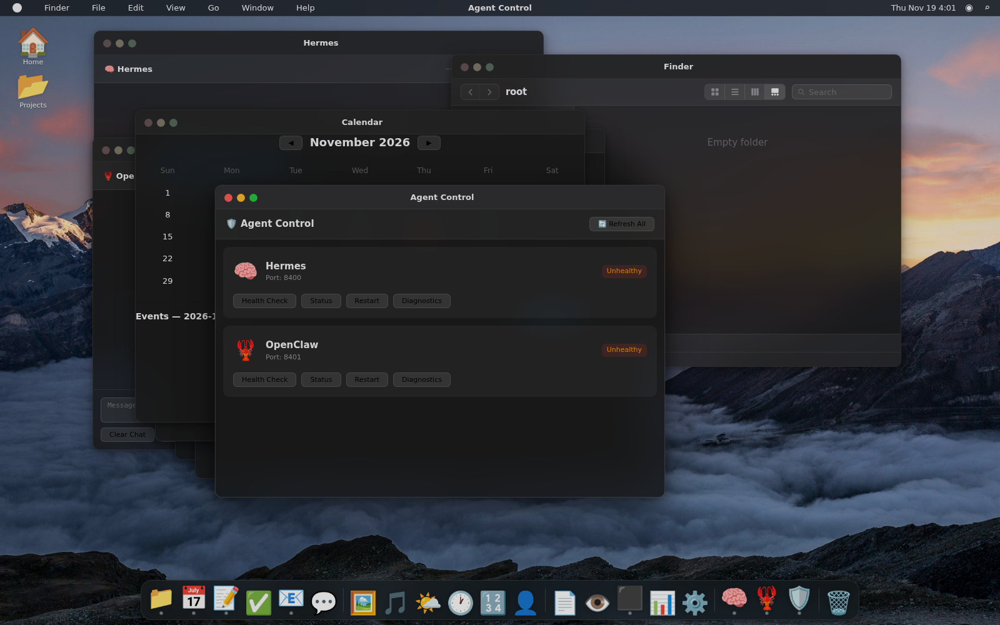

# Run 01 - Kimi K3 (baseline, July 2026)

**Model:** Kimi K3 (Moonshot) - open weights
**Driver:** autonomous coding agent, 3 overnight sessions (implementation → audit/repair → final polish)
**Stack chosen by the model:** Node + Express + Socket.IO + vanilla JS frontend (stack is never mandated; this is what K3 picked)
**Runtime:** Linux VPS, served over HTTP, real filesystem behind a whitelisted API
**Build prompts (kept verbatim in repo root):** `KIMI_IMPLEMENTATION_PROMPT.md`, `KIMI3_CORRECTION_AND_CONTINUATION_PROMPT.md`, `KIMI3_LOGO_FIX_PROMPT.md`, `KIMI3_FINAL_POLISH_PROMPT.md`

## How this run is graded

Seven hard requirements from the fixed task spec ([eval/task-spec.md](../../eval/task-spec.md)), scored 0-2 each (0 missing, 1 partial, 2 full), plus scope beyond the spec. Evidence below; every claim links to a screenshot or a committed log.

| # | Requirement | Score | Evidence |
|---|---|---|---|
| 1 | Desktop shell (menu bar, wallpaper, icons, context menu) | 2/2 | [desktop](../../screenshots/run-01-kimi-k3/01-desktop.png), [context menu](../../screenshots/run-01-kimi-k3/10-context-menu.png) |
| 2 | Window manager (drag, resize, traffic lights, animations) | 2/2 | STATUS.md + probe logs; any app screenshot |
| 3 | Dock (magnification, running dots, bounce/genie) | 2/2 | cosine magnification + launch bounce + genie minimize documented in STATUS.md |
| 4 | Spotlight (⌘-Space, fuzzy search, launch) | 2/2 | [spotlight query](../../screenshots/run-01-kimi-k3/02-spotlight.png) |
| 5 | Finder (real fs browse, 2+ views) | 2/2 | ships **four** views: [icons](../../screenshots/run-01-kimi-k3/03-finder-icons.png), [list](../../screenshots/run-01-kimi-k3/04-finder-list.png), [columns](../../screenshots/run-01-kimi-k3/05-finder-columns.png), [gallery](../../screenshots/run-01-kimi-k3/06-finder-gallery.png) |
| 6 | 12+ working apps | 2/2 | **21 apps**, 21/21 render in E2E |
| 7 | Server-side persistence (layout + settings survive reload) | 2/2 | persist.js results in STATUS.md (exact geometry + theme restore) |
| 8 | Filesystem API safety (allow-list; `/etc/shadow` → 403) | 2/2 | whitelist + denylist, probe results in STATUS.md |

**Total: 16/16 on hard requirements.** Scope beyond spec: 21 apps vs 12 required, 4 Finder views vs 2, full agent-control GUI ([screenshot](../../screenshots/run-01-kimi-k3/11-agentcontrol.png)), [Launchpad](../../screenshots/run-01-kimi-k3/09-launchpad.png), wallpaper pipeline, inline rename, Get Info.

**E2E (recorded July 2026, re-verified live 2026-11-19):** 21/21 apps render, 15/15 interaction probes, persistence intact. Screenshots in this page were captured 2026-11-19 from the continuously-running baseline.

## What worked

- One implementation pass produced a complete, coherent shell with correct architectural instincts (app registry, window-manager separation)
- The audit/repair pass caught and fixed real bugs: window keys, persistence contract, fs hardening gaps
- Polish pass hit genuine macOS feel: genie minimize-to-dock, cosine dock magnification, multi-layer focus shadows
- It built agent GUI panels unprompted - thinking beyond the letter of the brief

## What failed / cost extra sessions

- First pass shipped a broken Apple logo asset → dedicated fix session
- App dispatch contract and persistence needed a correction round (found in audit, not self-caught)
- The July E2E harness ran ephemerally inside agent sessions and was **not committed** at the time; supervisor logs + STATUS.md preserve the results. Neutral cross-model harness is roadmap task #1

## Evidence gallery (captured 2026-11-19, headless Chromium 1600x1000)

| Desktop | Spotlight ("notes") | Launchpad |
|---|---|---|
|  |  |  |

| Finder icons | Finder list | Finder columns | Finder gallery |
|---|---|---|---|
|  |  |  |  |

| Notes | Calendar | Context menu | Agent control |
|---|---|---|---|
|  |  |  |  |

## Human pass

**84/100 - Kimi K3 baseline** (operator provisional score, 8.4/10 on the [100-point rubric](../HUMAN_EVAL_RUBRIC.md) axes, self-reported via the agent report Nov 19; final visual walkthrough to be confirmed by the operator on the live build).

## Still pending for run-01

- Neutral-harness re-score: run-01 gets the same 8-check black-box instrument as every later run

## Build story

1. **Session A:** initial macOS-inspired desktop, window manager, 21 app skeletons
2. **Session B:** audit + repair (app dispatch, persistence, menubar, control center, trash backend, fs hardening), Apple HIG design pass, performance + QA phases
3. **Session C:** final polish (Finder rewrite to 4-view grade, dock physics, genie minimize, wallpaper, context menus) - verified 21/21 + 15/15

Raw agent logs live in `supervisor/` and `kimi*.log` at the repo root, kept intentionally: where the model struggled is part of the benchmark's value.
