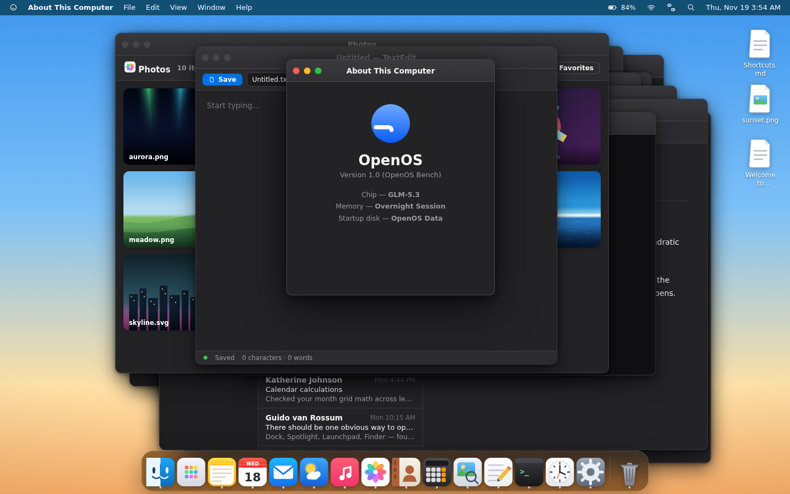

# Run 02 - GLM-5.3 (2026-11-18/19)

**Model:** GLM-5.3 (Z.ai), open weights, served via the operator's inference key
**Harness:** same nightly worker as all runs - one autonomous overnight session, frozen task spec v0, empty scaffold (package.json + express/socket.io only)
**Session:** 22:10 → 23:30 PT (~80 minutes wall-clock)
**Stack chosen by the model:** vanilla JS ES modules (33 modules, no bundler) + Express backend, self-authored CDP-based E2E + screenshot tooling

## Score

| Metric | Result |
|---|---|
| Self-test suite (21 checks, hit-test based) | 21/21 - **independently re-run and confirmed by the bench operator** |
| Apps in dock | 16 (finder, launchpad, notes, calendar, mail, weather, music, photos, contacts, calculator, preview, textedit, terminal, clock, settings, trash) |
| Persistence | ✅ layout + theme survive reload (server-side JSON) |
| Security probes | ✅ `/etc/shadow`, `..` traversal, symlink tricks, out-of-allow-list writes → 403 |
| Boot experience | ✅ ~2s boot screen with progress bar (model's own flourish) |
| Human pass | pending (morning walkthrough) |

## Evidence screenshots

Captured with the run's own CDP screenshot tool against the live server. Note: window-state captures show subtle deltas only - the neutral cross-model screenshot harness (roadmap task #1) will standardize this for all future runs.

## Full build

The complete model-authored build is committed at [`runs/run-02-glm-5.3/`](../../runs/run-02-glm-5.3/) (node_modules excluded). Two public-hygiene scrubs were applied to the committed copy: an internal temp path in `server.js` and a provider label in `STATUS.md`; no functional changes.

## What impressed

- Built its own E2E harness + PNG color-probe tooling unprompted, because the spec said it would be scored - meta-compliance with the benchmark
- `safeResolve()` filesystem hardening is genuinely careful: realpath-resolves the deepest existing ancestor before the allow-list check, defeating symlink and `..` tricks
- Honest STATUS.md: it self-reports its limitations (mock Mail/Weather data, localStorage-only photo favorites)

## What didn't

- Photo favorites persist client-side only (spec asked for server-side persistence; partial credit)
- Mail and Weather are mock shells (spec allowed mock data, but no interaction depth)
- 80 minutes to a feature-complete desktop is fast - suspiciously fast; the neutral harness will probe whether polish was traded for passing checks

## Verdict vs baseline

GLM-5.3 reached the spec's hard requirements in one 80-minute session where K3 took three overnight sessions for a broader 21-app build. Scope differs (16 dock apps vs 21 apps, no column/gallery Finder views yet); discipline is high. Final placement after the human pass.
