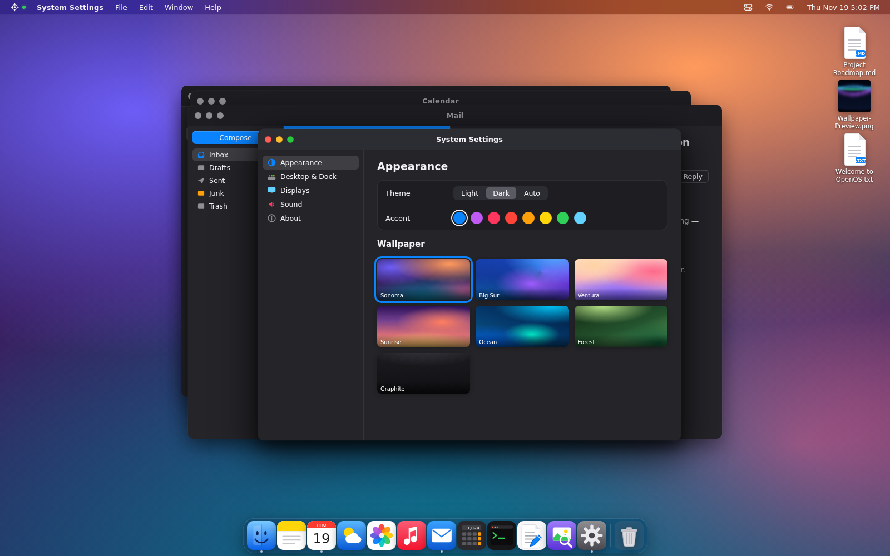
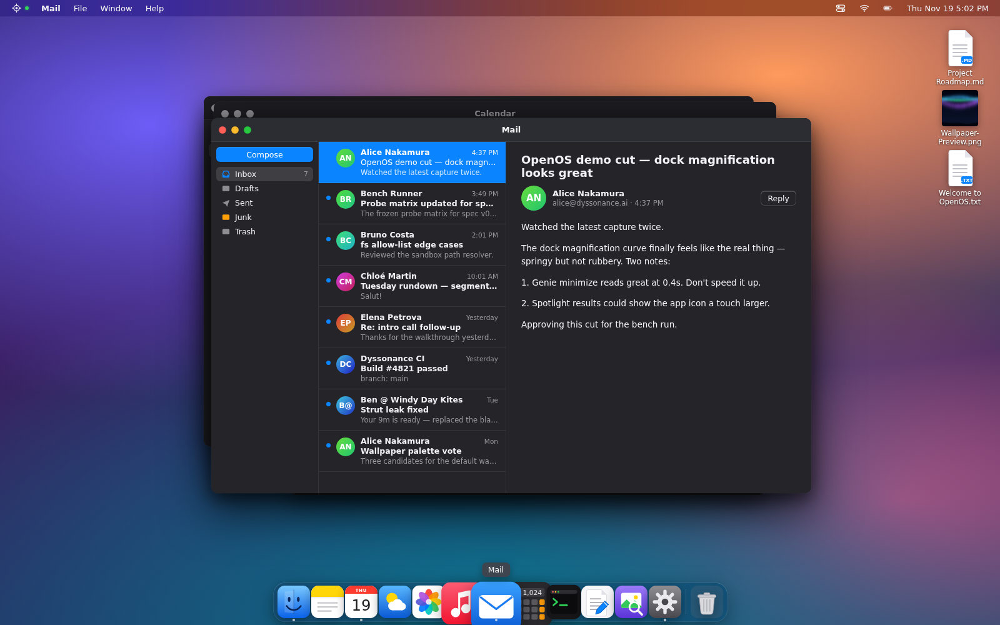
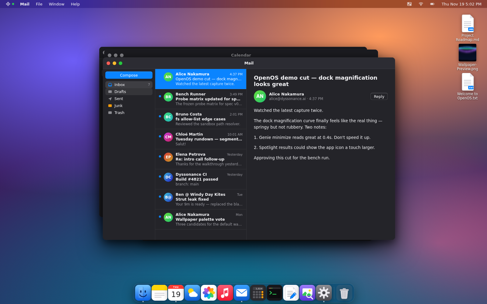
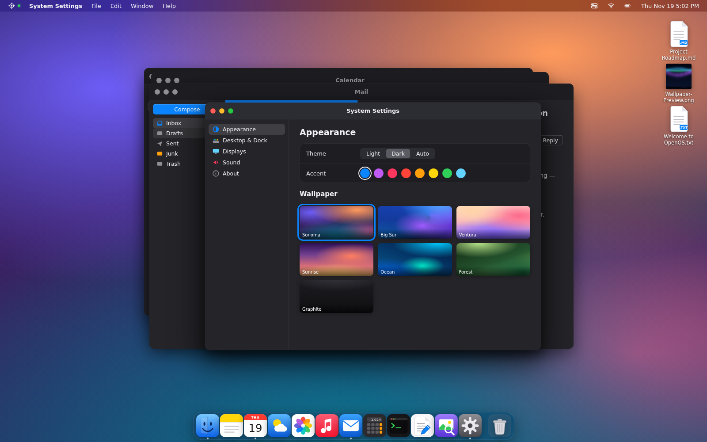

# Run 03 - Qwen3.8-Max (2026-11-19)

**Model:** Qwen3.8-Max (Alibaba), open weights, served via the operator's inference key
**Harness:** same nightly worker as all runs - one autonomous overnight session, frozen task spec v0, empty scaffold (package.json + express/socket.io only)
**Session:** 03:58 → 05:20 PT (~82 minutes wall-clock) - same budget class as run-02's 80 minutes
**Stack chosen by the model:** vanilla JS ES modules (17 core + 16 app modules, no bundler) + Express + socket.io, hand-written CSS, pure-Node PNG encoder for asset seeding

## Score (tier tags per [docs/EVALUATOR.md](../EVALUATOR.md))

| Metric | Result |
|---|---|
| **Tier 1 - structural click path** | **72/100 (struct)** - provisional, measurable axes only; agent/VPS 25 and full visual 15 excluded |
| Neutral harness v0.1 (black-box, 8 checks) | **7/8 (88%)** - sole failure `spotlight.overlay-detect`, adjudicated as probe artifact (below) |
| Self-suite (recorded, never leaderboard) | 50/50 probes, 0 page errors - model-authored `tests/smoke.cjs`, independently re-run pass |
| Tier 2 - vision pass | pending infra (vision endpoint 400s on this host) |
| Tier 3 - operator pass | not yet walked; never a gate |

## Probe-artifact adjudication (honesty notes)

- **Spotlight:** the generic harness fires Ctrl+Space *and* ⌘+Space back-to-back with no gap; on this build that toggles the overlay open then closed, so the frame-diff sees nothing. A targeted probe confirmed the overlay opens (dedicated `spotlight/sp-search/spotlight-results` DOM, 838→950 nodes on the chord) and Enter-launch works (7 window-class elements after typing `calc` + Enter). Recorded as **works; instrument gap** - same class of miss as run-02.
- **Typed-text persistence (click path step 8):** false in the generic probe - it types into whatever field a geometry-based dock click happens to open. Server-side persistence itself passed the model suite and the neutral harness's reload check (layout + settings restored). Carried as probe artifact, same footnote as the run-01/02 comparison.
- **Launchpad (click path step 6):** **genuine fail** - the build ships no Launchpad. Unlike the two artifacts above, this one is the model's scope decision, and the score correctly keeps the loss.

## Evidence frames (click-path captures, state claims = probe-verified frame deltas only)

| Boot (non-blank probe) | App-open (unique frame) | Context menu (frame change) | Post-reload (restore verified) |
|---|---|---|---|
|  |  |  |  |

Full capture set in [`eval/harness/results/run-03-qwen3.8-max/`](../../eval/harness/results/run-03-qwen3.8-max/). Tier-2 vision pass upgrades the "what it actually looks like" claims when the endpoint is fixed.

## What impressed

- **Deepest per-app behavior of any single-session run so far**: generative WebAudio synth per Music track with live analyser visualizer, Mail with timed mock auto-replies + toast, sandboxed Terminal with tab-completion and neofetch, Clock with live analog SVG world clocks, genie minimize via WAAPI
- **Zero-dependency asset pipeline**: a hand-written pure-Node PNG encoder generating 12 procedural photos into `fsroot` - no network, no image libs
- **50/50 self-suite** with security aggregates (allow-list 403s on every verb, symlink realpath re-check) and a genuinely honest STATUS.md: it self-reports the blur-paint and multi-select limitations
- 372 KB of frontend for a 15-app desktop - the leanest payload in the bench

## What didn't

- **No Launchpad** (spec-adjacent scope miss; K3 and GLM both shipped it) - the one structural axis the probes penalize for real
- **15 windowed apps vs K3's 21**; no Finder column/gallery views (icon + list only)
- Finder multi-select absent; window content blur titlebar/sidebar-only (self-reported, with the perf reason stated)
- Boot latency 4.9 s measured by the click path - slowest recorded (no bundler, many ES-module requests)

## Verdict vs baseline

**Struct tie with GLM-5.3 at 72, for opposite reasons.** GLM lost points on breadth wiring; Qwen keeps wiring clean and loses real points on scope (no Launchpad, fewer apps). Against the K3 baseline (80, 3 sessions): Qwen matched the spec's hard requirements in one 82-minute session and beats K3's July build on per-app *depth* (Music synth, Terminal sandbox, persistence surface area), but K3 still wins on *width* - app count, four Finder views, Launchpad, agent GUI panels. This directly tests the hypothesis from the run-01/02 comparison: session budget, not capability, is what separates the single-night runs from the baseline. Qwen at 82 minutes delivers the most feature-complete single-session build yet.

## Tech stack chosen (rolling table)

| | Kimi K3 | GLM-5.3 | Qwen3.8-Max |
|---|---|---|---|
| Backend | Node + Express + Socket.IO | Node + Express | Node + Express + socket.io |
| Frontend | Vanilla JS (script tags) | Vanilla JS ES modules, 33 modules | Vanilla JS ES modules, 17 core + 16 app, no bundler |
| State | server JSON + socket sync | server JSON store | server JSON, atomic writes + sendBeacon flush |
| Testing | ephemeral suite (never committed) | self-built CDP harness + PNG probe | self-built puppeteer smoke suite (50 probes) - committed with the run |
| Assets | real + generated | mock | **pure-Node PNG encoder, 12 procedural photos** |

## Full build

The complete model-authored build is committed at [`runs/run-03-qwen3.8-max/`](../../runs/run-03-qwen3.8-max/) (node_modules, runtime state, and lockfile excluded). Hygiene scan: no internal paths, credentials, or provider labels in the committed copy.
