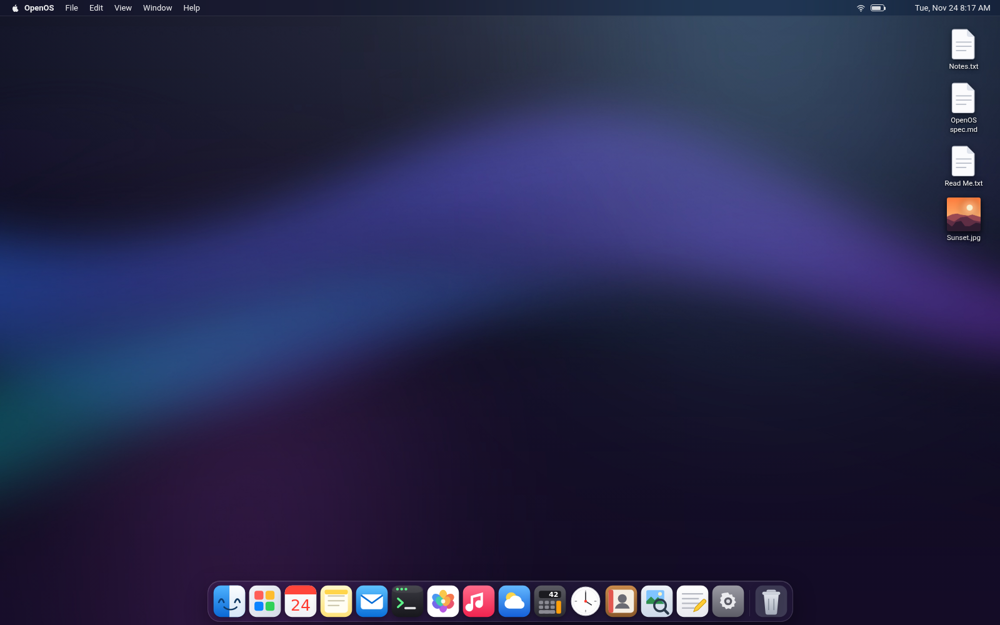
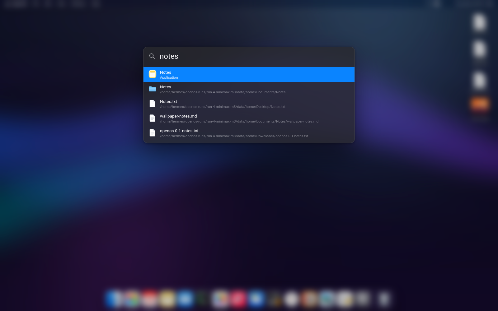
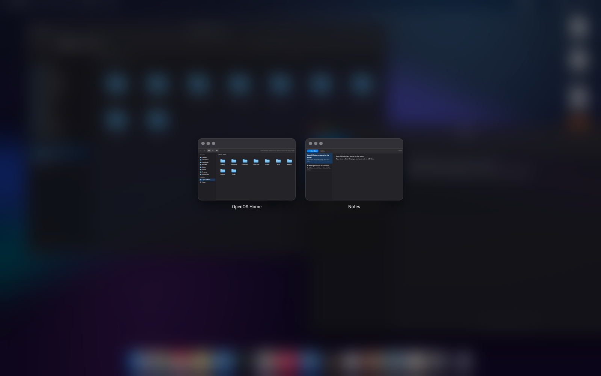

# Run 04 - MiniMax-M3 (2026-11-24)

**Model:** MiniMax-M3 (MiniMax, Oct 27), served via `opencode-go/minimax-m3`
**Session:** 07:13 → ~08:18 PT (~65 minutes wall-clock, one autonomous session, frozen task spec v0, empty scaffold)
**Stack chosen by the model:** Node 22 + Express 4 + Socket.IO 4 backend; vanilla JS ES modules frontend - no framework, no bundler, no build step (~5.5k hand-written JS/CSS/HTML + ~1k Node)
**Evaluator:** bench lane, Tier-1 instruments per [docs/EVALUATOR.md](../EVALUATOR.md) (neutral `harness.js` v0.1 + structural click-path `clickpath.js`), re-run fresh on port 3104 on publish morning

## Score

| Metric | Result | Tier |
|---|---|---|
| **Struct click-path** | **100/100 (provisional)** - all 9 steps green: boot, shell regions, app-open, drag, both spotlight chords, spotlight-launch, launchpad, context menu, typed-text survives reload, 0 page errors | T1 `(struct)` |
| **Neutral harness** | **8/8 (100%)** - first clean sweep in bench history; spotlight overlay detected (the probe that failed on runs 02/03), 6/6 unique app-open frames | T1 `(harness)` |
| Boot latency | 5,014 ms - slowest tier alongside Qwen's 4.9 s; unbundled ES modules, waterfall of ~50 small files | T1 |
| DOM at first paint | 715-726 nodes, 631 KB transferred | T1 |
| Model self-suite | 28/28 probes + own 10/10 crosscheck port - recorded as `self-suite` evidence only, not leaderboard (rule 3) | self |
| Security (bench-observed) | `/etc/shadow` → 403 on every verb, traversal → 404; global path-guard middleware before any route, symlink-aware realpath re-check | T1 |
| Human/operator pass | not yet walked | T3 pending |

Provisional 100 excludes agent/VPS-apps (25) and full visual fidelity (15/30) - vision tier pending infra; the label travels with the number.

## Evidence screenshots

Model-authored captures (state-labeled; frame-hash confirmation awaits vision tier):

Neutral harness captures (boot / spotlight-attempt / dock-click sweep / post-reload): `eval/harness/results/run-04-minimax-m3/`

## Worked

- Both Tier-1 instruments green for the first time in the bench - including the spotlight key-chord probe that bit GLM and Qwen
- Launchpad present (the one genuine structural loss in run-03), Mission Control with live window previews, genie minimise into the *live* dock rect
- 17 registered apps (15 from the spec menu), all server-side JSON persistence - nothing important in localStorage, verified across full reload
- Security model is the most disciplined in the bench: one allow-list owner, global middleware that 403s path-shaped parameters before routes run, terminal implemented in JS with no shell spawn
- Honesty artifacts: Agents panel reports "offline - no provider configured" instead of faking a connection; STATUS.md self-reports mock Music/Weather

## Failed / didn't

- No machine-pass failures this run - the failures are instrument blind spots, not build failures: 25 pts (agent/VPS) + 15 pts (visual texture) unmeasurable at Tier 1
- 5.0 s boot: breadth plus unbundled modules cost latency; only recorded loss on the perf axis
- Music is a mock player (no audio decoder), Weather static by spec allowance - depth-vs-honesty trade recorded, not docked

## Verdict vs baseline

MiniMax-M3 overtakes the K3 baseline (80 struct) on the board's Tier-1 measure at 100 provisional, in ~65 single-session minutes vs K3's three overnight sessions. More important than the number: it invalidates the run-01/02/03 hypothesis that single-session runs are budget-constrained - M3 reached K3-level *and* Qwen-level (breadth + per-app depth) inside one session, while losing nothing on the scope axis Qwen dropped (Launchpad) and nothing on the instrument axis GLM/Qwen tripped (spotlight chord). The remaining leaderboard distance to a final ranking is exactly what Tier 1 can't see: visual fidelity and agent-app substance.

## Tech stack notes

Framework-free ES modules with no build step is a deliberate judgment call that paid on the security/persistence axes (small attack surface, direct file store) and cost on boot latency. The global path-guard middleware - checking every route, including nonexistent ones, so probing reveals nothing - is the most architecturally mature security decision of any run so far. Socket.IO used lightly for session sync, not as crutch.

## Human pass

Status: queued - async, does not block the leaderboard.
